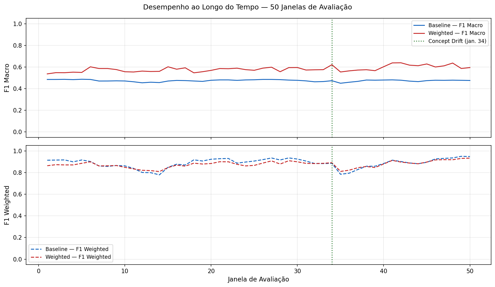
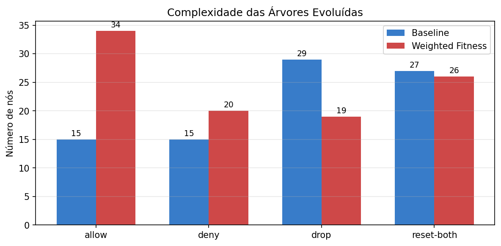
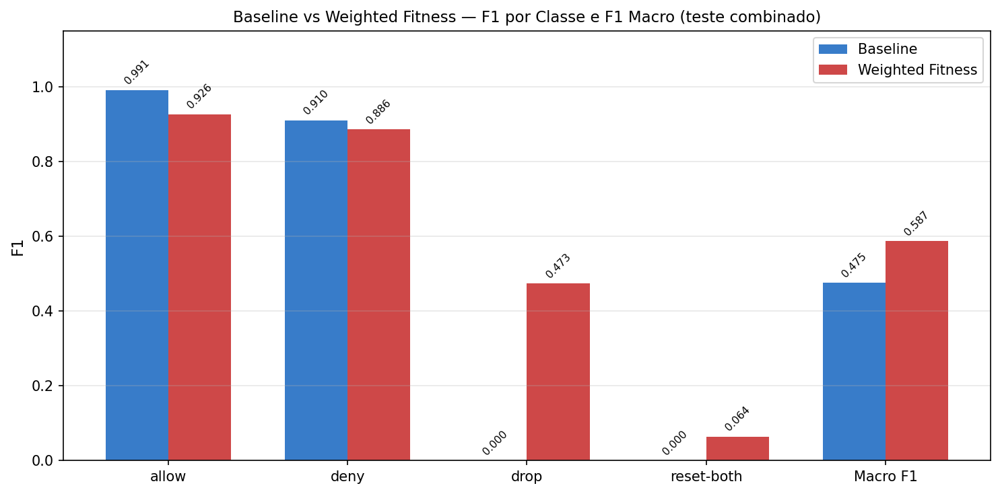

<div align="center">

# Classificação de logs de firewall com Programação Genética

### Programação Genética evolui classificadores interpretáveis para 1,5 milhão de sessões reais de firewall, aprende as classes raras e se mantém estável sob concept drift.


</div>

*English summary at the end.*

| **1,5M** | **0,475 → 0,587** | **0 → 0,47** | **0,582 ± 0,026** |
|:---:|:---:|:---:|:---:|
| sessões de rede reais, tratadas como fluxo | F1-macro com fitness ponderada | F1 da classe rara drop | F1-macro estável em 50 janelas temporais |

Classificação da ação tomada por um firewall corporativo (**allow, deny, drop, reset-both**) em **1,5 milhão de sessões de rede reais**, tratadas como um fluxo de dados com **concept drift**. O classificador é evoluído por **Programação Genética** (DEAP): uma árvore de expressão por classe, que resulta em modelos compactos e interpretáveis.



## Resultados (teste: 1.062.415 sessões)

| Variante | allow | deny | drop | reset-both | **F1-macro** | F1-ponderado |
|---|---|---|---|---|---|---|
| Baseline (fitness = F1) | 0,991 | 0,910 | 0,000 | 0,000 | 0,475 | 0,888 |
| **Fitness ponderada** por frequência inversa de classe | 0,926 | 0,886 | 0,473 | 0,064 | **0,587** | 0,877 |

- A fitness ponderada faz o modelo **aprender as classes raras** (drop sai de 0 para 0,47) trocando pouco do F1-ponderado.
- **Robustez ao drift:** F1-macro estável entre os dois períodos de coleta (0,578 → 0,606) e nas 50 janelas temporais (0,582 ± 0,026).

## O que tem aqui
- **Split temporal** (30% inicial para treino, 70% para teste), sem embaralhar, simulando produção.
- **One-vs-rest com GP:** população 200, 40 gerações, crossover 0,7, mutação 0,3, torneio 5, altura máxima 6, semente 42.
- Avaliação **global, por fase** (antes e depois de 15 dias de intervalo) e **por janela temporal**.
- Avaliação vetorizada com NumPy: cada árvore é avaliada em 455 mil exemplos por geração.
- Relatório em formato de artigo (template SBC), em inglês: [`report/paper.pdf`](report/paper.pdf).

| | |
|---|---|
|  |  |

## Dados
Os logs foram coletados pelo firewall de uma universidade (>15 mil alunos) e fornecidos pela disciplina. **Eles não estão neste repositório porque contêm endereços IP reais.** Para reproduzir, coloque os dois CSVs em `data/`:
- `Log-Completo-Todos-Atributos-Importantes.csv` (fase 1)
- `log-completo-Todos-Atributos-Importantes-fase-online-2.csv` (fase 2)

Os endereços IP não são usados como atributos do modelo.

## Como reproduzir
```bash
pip install -r requirements.txt
jupyter notebook firewall_log_gp.ipynb
```
O treino levou ~7–9 minutos por variante na execução original (CPU).

## Autores
Projeto em grupo: **Renato Calacina Spessotto**, Jean Patrick Ngandu Mamani e Guilherme Torquato.

---

## English summary
Genetic Programming (DEAP) classifier for firewall actions on 1.5M real network sessions treated as a stream with concept drift. One expression tree per class, temporal train/test split, and evaluation per phase and over 50 time windows. Inverse-frequency weighted fitness raises **macro-F1 from 0.475 to 0.587**, learning rare classes (drop F1 0 → 0.47) while staying stable across drift. Paper-style report (SBC template) in [`report/paper.pdf`](report/paper.pdf). Raw data is not included because it contains real IP addresses.

*Projeto desenvolvido na disciplina SCC0370 (Introdução à Computação Bioinspirada), ICMC/USP, 2026.*
